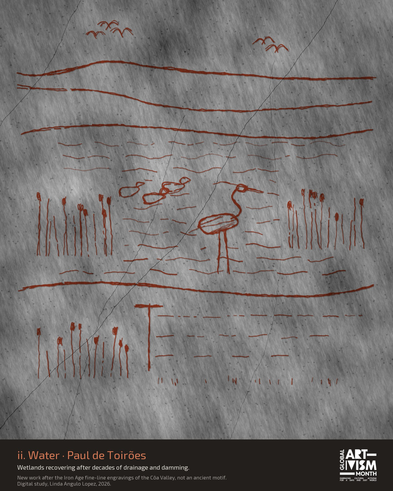

# Cartography

**Summary**: Maps, story maps, and the visual/narrative design of geographic storytelling.
**Last updated**: 2026-11-22 (pointer: the Wild Coast seafloor story map and an ArcGIS Online tutorial); 2026-11-20 (the SIST map-server thread continued: security, GeoServer's data-model outputs); 2026-11-19 (evening: QGIS Server vs GeoServer vs MapServer, a thread on the CNRS SIST list); 2026-11-15 (Women+ in Geospatial GIS Day 2026 panel on AI, 18 Nov; Linda's 2020 StoryMap *Stamp Out COVID-19*); 2026-11-07 (Water plate archived here from the home page); 2026-11-06 (night: RustGIS v0.5.0); 2026-10-29 (pointer: ODP Academy course with a QGIS module); 2026-10-24 (pointer: Claire Tenu's landscape photo observatories, Fontainebleau and the Seine in Normandy); 2026-10-13 (Les Rencontres QGIS-fr 2027 announced for Lille)

---

- See [[Conservation]] for *The Wild Coast seafloor* (22 Nov 2026), my ODP Academy Module 2 exercise: maps made in a Python notebook, in QGIS and in ArcGIS Online, plus an [ArcGIS story map](https://arcg.is/1GHyu43) and a tutorial, [From Download to Map in ArcGIS Online](https://lindangulopez.github.io/odp-academy-2026/module-2-arcgis-online/), for doing the course's ArcGIS lesson without an ArcGIS Pro licence.

- *QGIS Server vs GeoServer vs MapServer: which map server, and why?* (thread on the CNRS SIST list, 19 Nov 2026, in French; names left out here): a research engineer in climatology asked why most SIST members seem to run GeoServer rather than QGIS Server, and who runs both. A geomatician's answer: MapServer and GeoServer came first and both perform well, roughly equivalent; GeoServer won ground through its admin interface and ease of management, while MapServer suits people who like editing mapfiles directly and scripting (historically with PHP); GeoServer's Java base was a hurdle for some. QGIS Server is newer and "certainly performant", but mainly worth it with a layer such as **Lizmap**, which goes beyond a map server. His rule of thumb: for a general web-mapping project, **QGIS Server + Lizmap**, with MapServer alongside for fast basemaps if needed; without that layer (or if you build your own), MapServer or GeoServer. Useful for the GeoDjango track's choice of map server. **Follow-ups, 20 Nov**: (i) the original poster asked about **security**: QGIS Server feels "open bar", with no roles per published data source, which is limiting as soon as access has to be managed. (ii) A contributor from BRGM (the French geological survey): GeoServer can be configured entirely **by script and REST API**; its **Features Templating** and **app-schema** extensions publish data that follows a data model (WFS, OGC API Features, even WMS GetFeatureInfo), a big plus for **FAIR data exchange** rather than map-making alone; the **Smart Data Loader** plugin maps relational databases with non-flat models; and for security, a **token is passed between the application layers and GeoServer**, so each person sees only what they are allowed to. Keywords: QGIS Server, GeoServer, MapServer, Lizmap, web mapping, OGC services, app-schema, access control. Related: [[Data]], [[Python]].
- *GIS Day 2026: The Future of AI is Still Human* ([Women+ in Geospatial](https://www.womeningeospatial.org/), Luma registration confirmation, 15 Nov 2026; no public event page found by web search): a free virtual panel on Zoom, **Wed 18 Nov 2026, 18:00-19:00 CET** (9-10 AM PST, 5-6 PM GMT), under this year's official GIS Day theme *GIS: Powering Purpose and Innovation*. Speakers from NASA Goddard Space Flight Center, Esri and the USDA Forest Service (names to be announced) discuss what AI makes possible in GIS, how to turn AI-generated insights into trustworthy real-world decisions, why human judgement still matters, and what GIS professionals should learn or rethink as AI evolves. Keywords: GIS Day 2026, GeoAI, Women+ in Geospatial, human judgement, NASA, Esri. Related: [[Machine_Learning]], [[Remote_Sensing]], [[Careers_and_Leadership]].

- [Stamp Out COVID-19](https://storymaps.arcgis.com/stories/6538ed37095b428cb52351dd98ecb901) (Linda Angulo López, ArcGIS StoryMap, published 3-4 Dec 2020; item record read on ArcGIS Online, the story itself does not render for automated reading): Linda's StoryMap for Esri's MOOC *Spatial Data Science: The New Frontier in Analytics*, opening with "An apple a day keeps the doctor away". It maps SNAP (food stamp) participation across U.S. counties in ArcGIS Pro, finds trends with a space-time cube, hot spot and emerging hot spot analysis, covers COVID-19 food relief, links interactive dashboards, and sets out the steps for building an ArcGIS Pro StoryMap. Keywords: StoryMap, spatial data science, emerging hot spot analysis, space-time cube, SNAP, food assistance. Related: [[Publications]], [[Data]], [[Urban_Planning]].

- [RustGIS](https://rustgis.app) v0.5.0 (Qiusheng Wu's LinkedIn post, shared 6 Nov 2026; site checked; code under the opengeos GitHub organisation): a fast, free and open-source desktop and browser GIS written in pure Rust, for Windows, macOS, Linux and the web ([web app](https://web.rustgis.app)). Data stays on your machine unless you send it to an AI model you choose, and every action is a command you can script. Release 0.5.0 (231 pull requests, 24 contributors, 11 first-timers) adds an expression language for queries and symbols, richer symbols and labels (hatch, gradient and shapeburst fills, label halos), overlay tools (Intersect, Union, Identity, Near, Merge, Kernel Density, a stronger Spatial Join), saving edits to GeoPackage and PostGIS with autosave, WMS and WMTS on a time slider, chunked reading of large Shapefile, GeoPackage, FlatGeobuf and GeoParquet layers, PMTiles export, and a Qt map widget for Python. The site also lists an MCP server and a Python package. Keywords: RustGIS, open-source GIS, Rust, GeoParquet, PMTiles, opengeos. Related: [[Open_Source]], [[Python]].

- See [[Data]] for the ODP Academy course *Working with Ocean Data on ODP* (9 Nov-10 Dec 2026, free), whose second module maps ocean data in QGIS or ArcGIS.

- See [[Conservation]] for Claire Tenu's *Observatoires photographiques du paysage* (Avenir Radieux, 2026, noted in the AFF bulletin of October 2026): two landscape photo observatories, the Seine in Normandy and the Fontainebleau forest, where fixed viewpoints, several of them rebuilt from old engravings, paintings and postcards, are photographed again over time to track how a landscape changes. Keywords: landscape photo observatory, repeat photography, Fontainebleau, Claire Tenu.

- *Les Rencontres QGIS-fr arrivent à Lille fin mars 2027!* (`raw/Gmail - Les Rencontres QGIS-fr arrivent à Lille fin mars 2027!.pdf`, OSGeo-fr mailing list, 13 Oct 2026): Announcement that the next **Rencontres des Utilisateurs Francophones de QGIS** — co-organised by OSGeo-fr and the Région Hauts-de-France — will be held 22-24 March 2027 in Lille, following last year's edition in Brest. OSGeo-fr is looking for both volunteers to help organise the event and sponsors/patrons (organisations and companies using QGIS) to support it financially; more details promised via a forthcoming dedicated website. Same francophone open-source-GIS community as the QField release coverage already logged under [[Open_Source]]. Keywords: QGIS-fr, Rencontres, OSGeo-fr, Lille, francophone GIS community, open-source GIS. Related: [[Open_Source]].

- *"Movement, Water, Connection" — Côa Valley Global Artivism Month gallery, now live* (public, [coa-connectivity-lab.github.io/global-artivism](https://coa-connectivity-lab.github.io/global-artivism/), four languages — English, Portuguese, Spanish, French; captured 26 Sept 2026): The public gallery page realising the StoryMap/illustration-plus-connectivity-map pairing already tracked on this page and in [[Publications]], now built as coa-connectivity-lab's own registered action for [[Safe_and_Just|Global Artivism Month]] (1 Nov-10 Dec 2026). Credit: Linda Angulo Lopez, coa-connectivity-lab, 2026, Greater Côa Valley, Portugal. Three plates, each pairing a field-drawing description with a rendered connectivity map from the [[Conservation|eco-connectivity pipeline]] (matching the [[Publications|preprint]]'s methods): **i. Movement** — Herbivores at Vale Carapito (plate in progress), paired with land connectivity for wolf, wildcat and red deer (Omniscape, fire-aware). **ii. Water** — Paul de Toirões wetland (plate in progress), paired with connectivity for species moving along rivers and streams (catchment-aware). **iii. Connection** — Côa gorge and Penascosa rock art (plate in progress), paired with multispecies mean connectivity, strongest along the lower Côa to the Douro. Twenty field sites visited August 2026, Fóios to Faia Brava; species records deliberately not shown, to protect sensitive animals. An accompanying essay, "Why draw and map the same valley," makes the project's own methodological argument explicit: drawing slows the eye to catch what the model misses (a new fence, a dry pool, a stone bridge an otter still uses), the map shows what a single walker cannot (pinch points where one new road would cut a corridor), and together they make a restoration argument the valley's own residents can read *and challenge* — closing on the same corrected "safe and just" framing and South African/Wild-Coast anchor as the [[Safe_and_Just|desk-study correction]] already logged there: "A corridor that works for wildlife is half the job. The other half is who gets to use it, and who decides." **Join the Côa call**: an open invitation to illustrators, field-notebook keepers, ecologists, farmers and anyone who lives near the Côa (or cares about a river of their own) — three levels matching Global Artivism Month's own structure (witness, contribute one page, co-create a shared map/zine of the Côa corridor). Timeline: sign-up 6-23 Oct, welcome pack/kick-off 26 Oct, the month itself 1 Nov-10 Dec with a new prompt every Monday and a round-up every Friday, closing gallery/zine 10 Dec (Human Rights Day). No GitHub account needed — a photo of a paper page suffices; a non-GitHub contact channel is to be added before sign-up opens. Rights: contributors keep their own rights; pages shared under CC BY-NC 4.0 unless otherwise requested; print inclusion is opt-in; no depicting people or exact sensitive-species locations in risk-creating ways. Explicitly not run by the central Global Artivism team — "a locally organised action registered for Global Artivism Month." The Portuguese/Spanish/French translations are still drafts, flagged for review before the 6 Oct sign-up opens. This turns the private planning draft already logged in [[Conservation]] private (`ideas.md`, 21 Sept 2026) into a live public page — see there for the plan's own open risks and outreach-channel notes, most still applicable. The live call is also posted as [GitHub Discussion #27](https://github.com/coa-connectivity-lab/eco-connectivity-workflow/discussions/27) ("who wants to take part as the lab?"), where Linda is still deciding the exact licence line and whether the movement's Terms and Conditions permit using the Global Artivism name for a sub-call. Keywords: Global Artivism Month, Côa Valley, field illustration, connectivity maps, Join the Côa call, CC BY-NC, safe and just. Related: [[Conservation]], [[Safe_and_Just]], [[Publications]].
  - *Plate ii, Water, Paul de Toirões* (shown on the home page 24 Oct-7 Nov 2026, archived here): [{ width="320" }](https://coa-connectivity-lab.github.io/global-artivism/#work) Wetlands recovering after decades of drainage and damming. A heron and ducks on open water, reeds taking the fields back, and the old straight ditches fading into the marsh, drawn after the Iron Age fine-line engravings of the Côa Valley. One of six digital studies (drawn by code, written with AI assistance) for Global Artivism Month, 1 November to 10 December 2026. Keywords: Global Artivism Month, Paul de Toirões, wetland, digital study, Côa Valley.

- *24 Heures du SIG 2026 — StoryMap competition entry* (correspondence 10-29 Aug 2026, `raw/Zimbra_SIG_coa.pdf`): Linda's own application to Esri France's "24 Heures du SIG" 2026 StoryMap competition (SIG 2026, digital track, 9 Oct 2026; project deadline 18 Sept 2026), submitting a three-chapter StoryMap titled *"Mouvement, Eau, Connexion : Renaturaliser la Grande Vallée du Côa"* (Movement, Water, Connection: Rewilding the Greater Côa Valley) — pairing field naturalist illustrations with GBIF occurrence data, resistance surfaces, and Omniscape connectivity modelling, plus Survey123 field data, aiming to make the [[Conservation|restoration science]] legible to a general audience; the application frames the project as resonating with the competition's special Jane Goodall Institute France prize. The organisers (Stanislas Pachulski) confirmed remote/digital participation doesn't affect competition eligibility, and that a prize would still be shipped to her even without an on-site representative. See [[Publications]] for the underlying draft-paper tracker and [[Professional_Background]] for the bio paragraph reused in the application. Keywords: 24 Heures du SIG, Esri France, StoryMap competition, Côa Valley, Jane Goodall Institute. Related: [[Conservation]], [[Publications]], [[Professional_Background]].

- *Côa Valley Story Map — Chapter Structure and Titles* (`storyMaps/5-ideas.md`, `storyMaps/scratch.md`): Design notes for a 5-chapter ArcGIS StoryMap built around the [[Conservation|eco-connectivity notebook]]'s own connectivity framework, reorganized around connectivity *type* rather than site/date. Opening frame: "Three Centuries of a Frontier — Almeida" (the 1766 fortress map pivoting to the same valley now managed for wildlife movement). Longitudinal/aquatic: "Water Without Borders" (Paul de Toirões + the Côa's barrier/dam history). Terrestrial: "Who Moves Through the Côa" (Vale Carapito, Sorraia horses, wolf prey-base argument). Threat case: "If the Price Is Biodiversity, Don't Call It Green" (Ribeira do Mosteiro, framed through Rewilding Portugal's SOPHIA opposition — see [[Climate_Change]]). Closing/political frame: "Two Rivers, Two Stories" (Porto/Douro comparison — see [[Conservation]] for the corrected dam-count figures this chapter needed verified). `scratch.md` works through 4 alternate titles and settles the open question of audience split: a technical Python/QGIS methods report for a scientific reader (reproducibility, resistance parameters, circuit-theory results) versus the ArcGIS StoryMap itself for a general audience (site/species/narrative first, model output only as a finished image) — two exports from one base dataset, kept deliberately distinct. Keywords: ArcGIS StoryMap, narrative structure, connectivity framing, audience split, chapter design. Related: [[Conservation]], [[Publications]].
- *Research proposal, portfolio placeholders and drafts, and Google-Doc-only stubs*: `portfolio/delivery-checklist.md` turns out to be a duplicate/revised field-trip plan (phased strategy, site priorities, a revised day-by-day calendar dated 17 Aug) rather than an actual delivery checklist — largely superseded by the more complete `Daily_Observation_Practice.md`/`Post-Development-Plan.md` already logged under [[Conservation]]. Separately, `research/vale-carpito/README.md`, `research/paul-de-toiroes/README.md`, `research/ribeira-do-mosteiro/README.md`, `references/maps/site-maps.md`, `references/photographs/photo-index.md`, and all three `illustrations/*/README.md` files are currently just pointers to the same shared project Google Doc, alongside the field-notes placeholders already logged under [[Conservation]] — no separate content yet in any of them.
