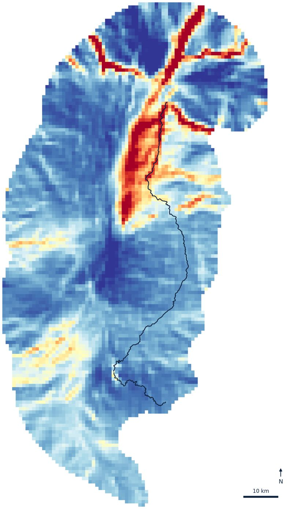

# A connectivity model you can read, and challenge

Where can a rabbit, a wildcat or a pond turtle actually move through the Greater Côa Valley? I posted a preprint on Zenodo that answers this with an open Python workflow, and with drawings.

<!-- more -->

{ width="420" }
/// caption
Multispecies connectivity, the weighted mean of land, water and air. The strongest corridor follows the lower Côa north to the Douro.
///

The workflow takes ten focal species, grouped by how they move: on land, in water, through the air. It fits Random Forest habitat models to GBIF records, turns them into resistance surfaces on a 100 m grid over 10,230 km², and solves current flow across the whole catchment. Three penalties sit on top: (i) recent fires from MODIS, which touched 10.07% of the grid since 2015; (ii) 22 barriers I recorded in the field, tiered by how easily animals cross them; (iii) the two UNESCO heritage areas.

I say plainly what the model cannot do. Training accuracies of 0.78 to 0.99 are not validation. The check I can offer is direction of effect: land resistance is 94.0 at fully blocking barriers and 88.6 at easy ones.

The preprint and the field-illustration gallery are two halves of one test: can a connectivity model be read, and challenged, by the people who live in the valley?

Preprint: [doi:10.5281/zenodo.22979020](https://doi.org/10.5281/zenodo.22979020).
