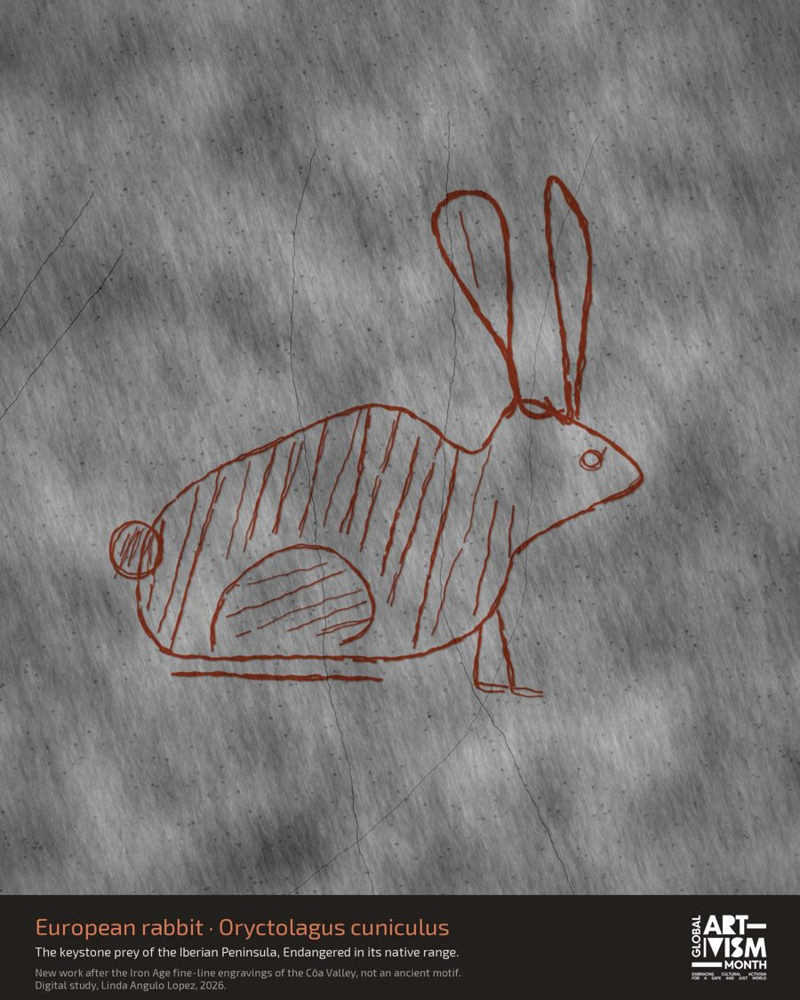
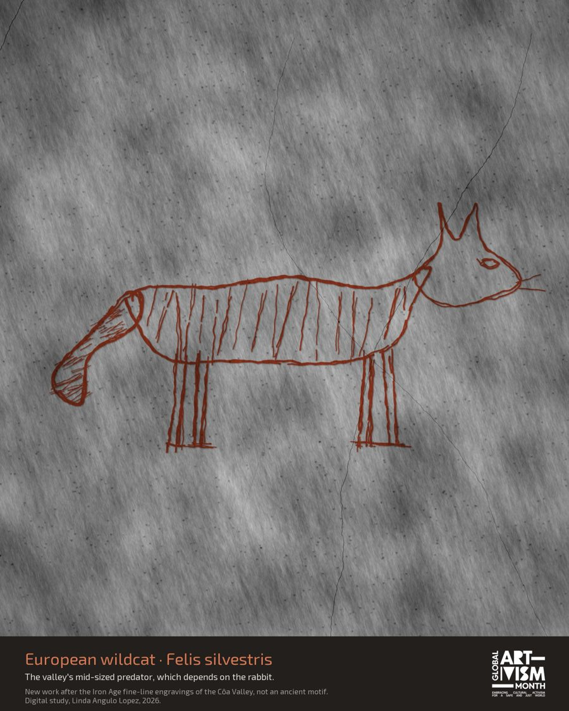
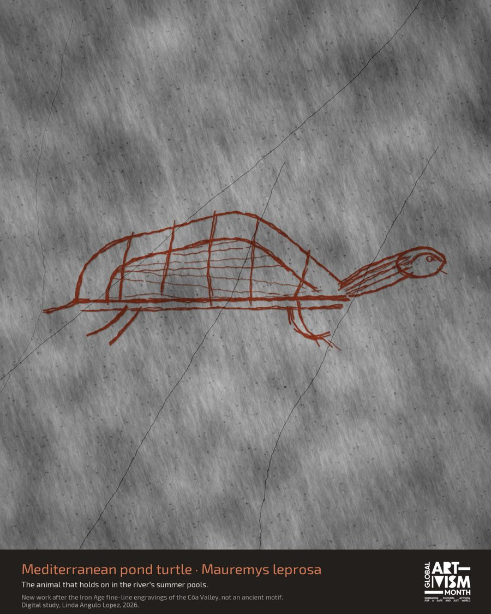

# New animals in an old line

For Global Artivism Month (1 November to 10 December 2026), I drew three animals of the Côa Valley in the fine-line style of its Iron Age engravings.

<!-- more -->

<figure><figcaption><strong>European rabbit</strong>The keystone prey.</figcaption></figure>
<figure><figcaption><strong>European wildcat</strong>The predator that depends on the rabbit.</figcaption></figure>
<figure><figcaption><strong>Mediterranean pond turtle</strong>The river animal that needs summer pools.</figcaption></figure>

The animals I chose are the three at the centre of my rewilding synthesis: (i) the European rabbit, (ii) the European wildcat, and (iii) the Mediterranean pond turtle. Each plate keeps one feature that identifies the species: the rabbit's ears and short tail, the wildcat's blunt ringed tail, the turtle's low shell and striped neck.

These are digital studies, drawn on a generated schist surface. The plates themselves are cut by hand. Each is captioned as a new work, not an ancient motif.

The method is Section 8 of the preprint [*Rabbits, wildcats, pond turtles and a river that stayed*](https://doi.org/10.5281/zenodo.22997241). The gallery is at [coa-connectivity-lab.github.io/global-artivism](https://coa-connectivity-lab.github.io/global-artivism/).

Can a drawing make a connectivity map easier to argue with?
