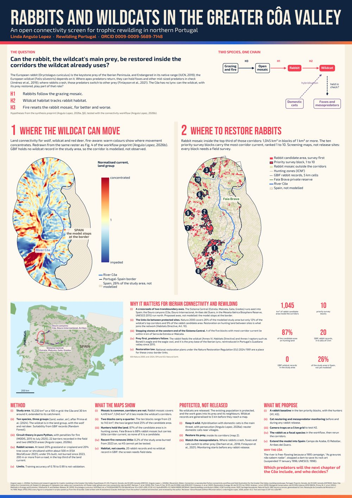

# Rabbits and wildcats: a poster for SER 2027

Version 0.2 of my poster for the 12th SER World Conference on Ecological Restoration (Lisbon, 30 August to 3 September 2027) is on Zenodo.

<!-- more -->

{ width="520" }

*Rabbits and wildcats in the Greater Côa Valley: an open connectivity screen for trophic rewilding in northern Portugal* asks one question: can the rabbit, the keystone prey of the Iberian Peninsula, be restored inside the corridors the wildcat already uses?

The numbers say where to look. Scrub-pasture mosaic suitable for rabbits covers 4,410 km² of the valley, but only 1,045 km² of it lies inside the wildcat's corridors, in ten priority survey blocks, and 87% of that is on hunting land. Natura 2000 holds only 12% of the wildcat's top corridors. So the restoration that joins the network happens on hunting land, between protected sites, and with hunters.

I propose (i) a rabbit baseline run with hunters, (ii) neutering of domestic cats and mesopredator monitoring before any release, (iii) camera traps on a 5 km grid, and (iv) extending the model into Spain. These are screening maps, not release sites.

Version 0.2 is narrower than the first: after a review on GitHub I dropped the pond turtle and kept the rabbit and the wildcat. Every figure is computed from open data, and the [source](https://github.com/coa-connectivity-lab/ser2027) is MIT licensed. Which predators will the next chapter of the Côa include, and who decides?

Poster: [doi:10.5281/zenodo.24013744](https://doi.org/10.5281/zenodo.24013744).
