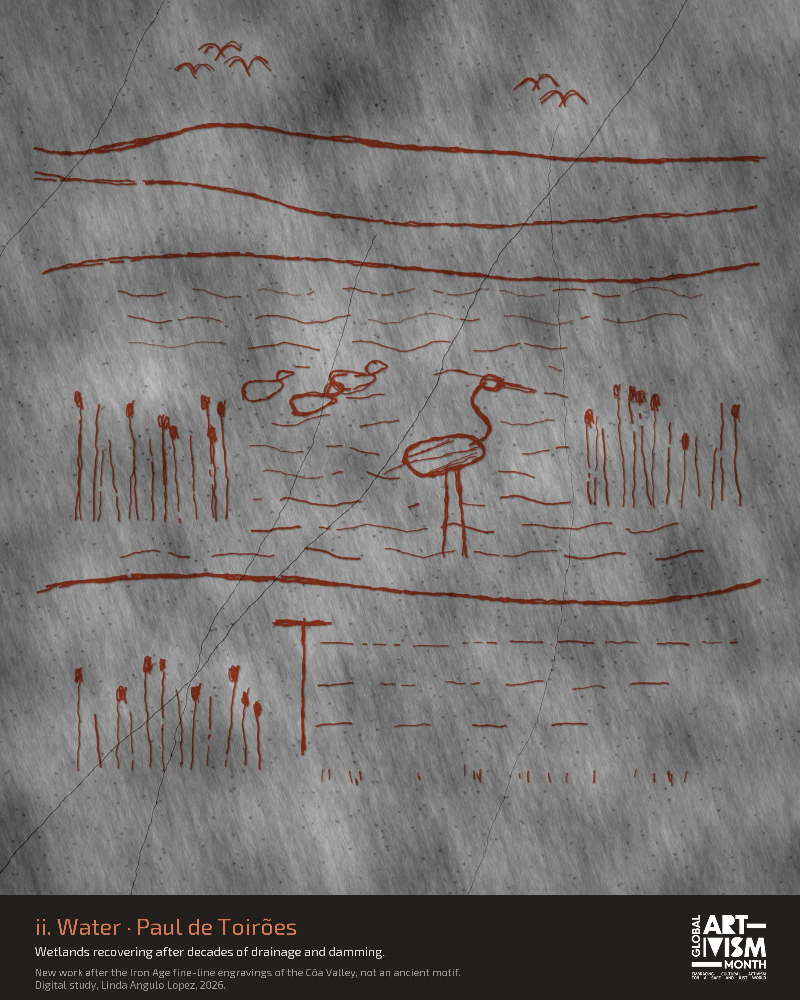

# Index

Table of contents of all notes pages.

---

!!! tip "Join online, Monday 2 November 2026: Environmental Harm as an International Crime"

    If ecocide becomes the fifth crime, who will be the first to answer for it? The Hague Humanity Hub puts that question to prosecutors, lawyers and photojournalists, as part of The Hague Climate Week 2026. 17:30-19:00 CET, livestreamed. **[Secure your spot](https://www.eventbrite.co.uk/e/environmental-harm-as-an-international-crime-livestream-tickets-2003656168537)** · [My post about it](https://www.linkedin.com/posts/lindangulopez_ecocide-internationalcriminallaw-icc-share-7518662787225726979-ayyI/) · More in [[Political_Ecology]].

!!! example "On the gallery: ii. Water, Paul de Toirões"

    [{ width="320" }](https://coa-connectivity-lab.github.io/global-artivism/#work)

    Wetlands recovering after decades of drainage and damming. A heron and ducks on open water, reeds taking the fields back, and the old straight ditches fading into the marsh, drawn after the Iron Age fine-line engravings of the Côa Valley. One of six digital studies (drawn by code, written with AI assistance) for Global Artivism Month, 1 November to 10 December 2026. **[See the gallery: Movement, Water, Connection](https://coa-connectivity-lab.github.io/global-artivism/)** · More in [[Cartography]] and [[Conservation]].

## Latest Finds

- [[Data]]: ARDoISE and OSERen hold a study day on research data in the environmental and social transition, Friday 22 January 2027, at the Centre Inria de l'Université de Rennes and online, with speakers from Data Terra and the Haut Conseil Breton pour le Climat.
- [[Reproducible_Science]]: Recherche Data Gouv lists 26 local "ateliers de la donnée"; eight of them, from Bordeaux to Lille, also support research code and software.
- [[Conservation]]: GEO BON and GBIF sign a Memorandum of Cooperation at COP17 in Yerevan on Wednesday 28 October, with a BON in a Box demo on querying cloud-optimised Darwin Core Data Packages.

## Topics

- [[Agentic_Coding]] — LLM-driven coding agents (e.g. Claude Code) for planning, building, and validating technical workflows.
- [[Remote_Sensing]] — Satellite and aerial imagery, sensors, and the data products derived from them.
- [[Agriculture]] — Farming systems, crops, and the tools and data used to study and manage them.
- [[Climate_Change]] — Climate trends, impacts, and the data and events used to study them.
- [[Embeddings]] — Vector representations of data, including foundation-model embeddings for earth/satellite imagery.
- [[Machine_Learning]] — Models, techniques, and applications of machine learning.
- [[Python]] — Python packages, libraries, and code notes.
- [[SQL]] — Database systems and SQL notes.
- [[Reproducible_Science]] — Practices and tooling choices that make scientific/analytical work reproducible.
- [[Data]] — Datasets and data sources of general interest.
- [[Conservation]] — Ecological connectivity, habitat protection, and conservation planning.
- [[Urban_Planning]] — Cities, urban form, and the environmental and social dynamics that shape them.
- [[Safe_and_Just]] — The "safe and just" framing (planetary boundaries + social foundations) applied to conservation and rewilding decisions.
- [[Decolonial_Ecology]] — Colonial and post-colonial environmental legacies, and how empire shaped land, water, and ecological policy.
- [[Political_Ecology]] — The politics of land, water, and wildlife: legal rights over nature, resistance, and tenure.
- [[Critical_Raw_Materials]] — The EU Critical Raw Materials Act in practice: benchmarks, Strategic Projects, and duties on permitting, site restoration, biodiversity and open geodata.
- [[Environmental_Justice]] — Who bears environmental harm: the right to a healthy environment, future generations, and fair access to remedies.
- [[Cartography]] — Maps, story maps, and the visual/narrative design of geographic storytelling.
- [[Publications]] — Status tracker for planned papers, StoryMap chapters, illustration plates, and blog posts from the Côa Valley project.
- [[Professional_Background]] — Linda's own career history in environmental governance, ecological restoration, GIS/database work, and open science.
- [[codeMeta_meeting]] — Working notes from CodeMeta community calls and recent CodeMeta project / research-software-metadata news.
- [[Open_Source]] — Open-source project contribution workflows, governance, and community tooling.
