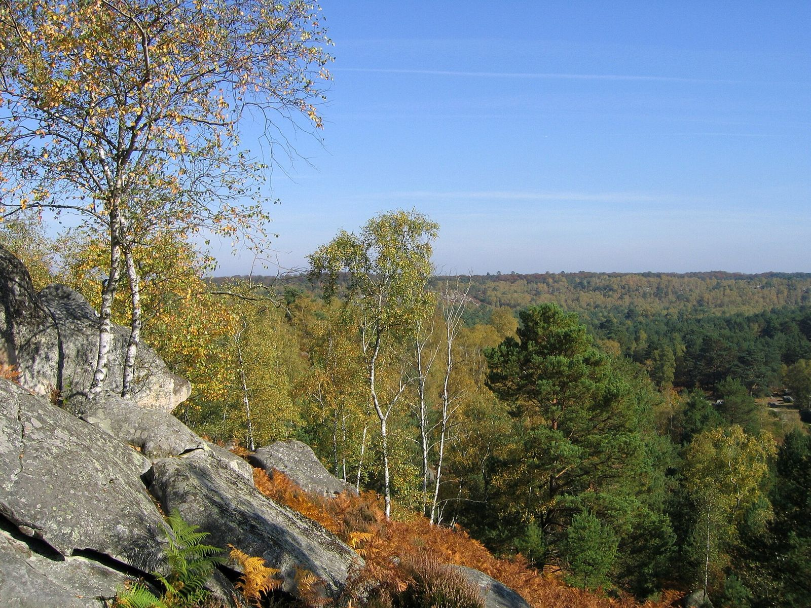
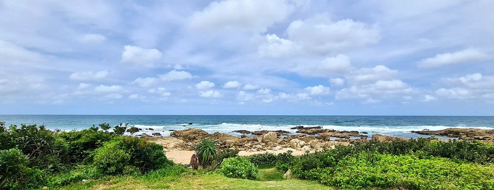
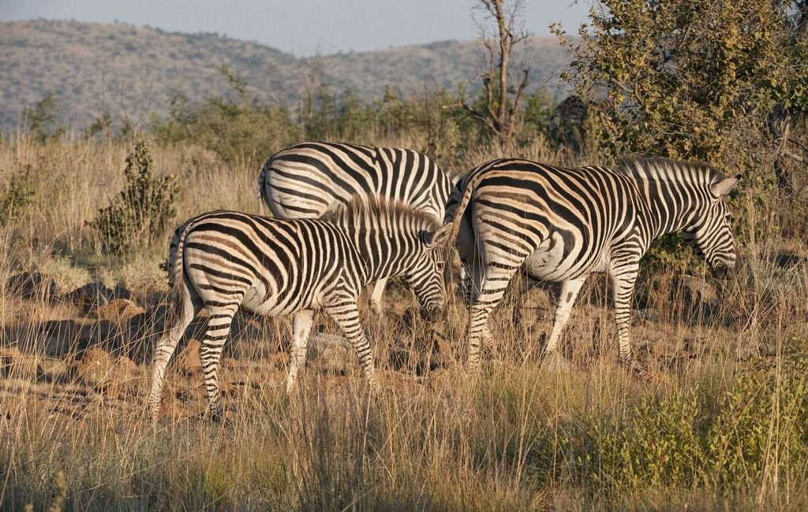
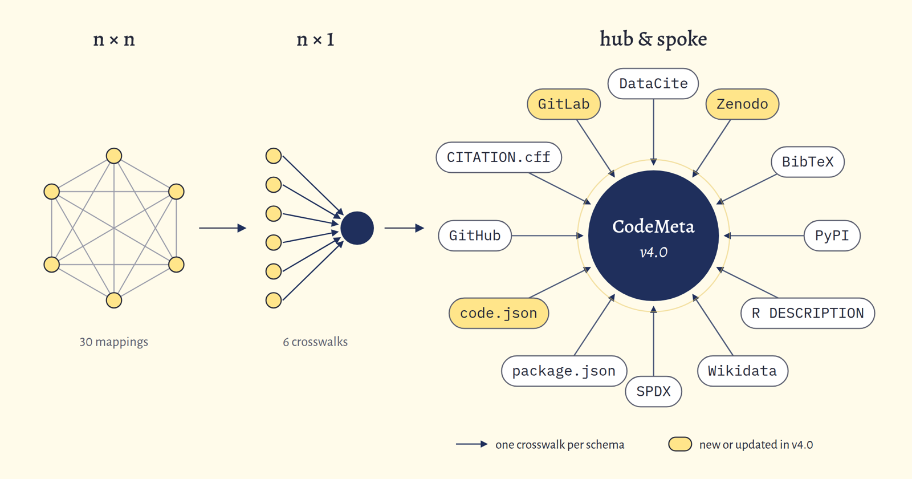
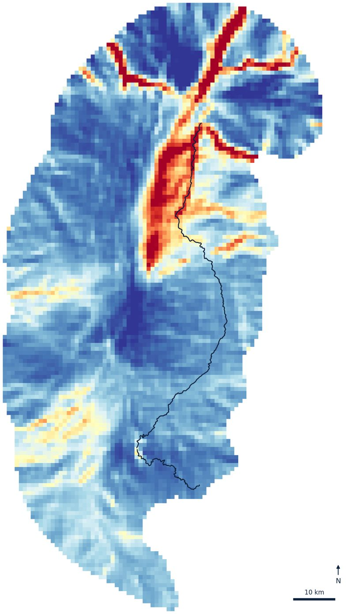

# Linda Angulo Lopez

Functional ecologist working in open science

I grew up in Port Shepstone, South Africa, and I live in Fontainebleau. I work at Software Heritage in Paris, helping research institutions archive, cite and describe the source code behind their science, and I am one of the authors of CodeMeta 4.0, the international metadata standard for research software. I also mentor people who use satellite data and GIS in Africa and the Caribbean.

4 min read

[Read the blog](blog/index.md){ .md-button .md-button--primary }
[Publications](Publications.md){ .md-button }
[CV](news.md#cv){ .md-button }
[News](news.md){ .md-button }

<a class="dest" href="#now-software-heritage"><small>Where I work</small>Paris</a>
<a class="dest" href="#home-fontainebleau"><small>Where I live</small>Fontainebleau</a>
<a class="dest" href="#where-i-started-south-africa"><small>Where I grew up</small>Port Shepstone</a>
<a class="dest" href="#where-i-started-south-africa"><small>Where I oversaw mine restoration</small>The Savanna</a>

Photos: Paris by <a href="https://commons.wikimedia.org/wiki/File:La_Tour_Eiffel_vue_de_la_Tour_Saint-Jacques,_Paris_ao%C3%BBt_2014_(2).jpg">Yann Caradec</a> (CC BY-SA 2.0) and the forest of Fontainebleau by <a href="https://commons.wikimedia.org/wiki/File:Rochers_en_for%C3%AAt_de_Fontainebleau11.JPG">Thesupermat</a> (CC BY-SA 3.0), via Wikidata; the Indian Ocean at Margate, on the South Coast near Port Shepstone, by <a href="https://www.flickr.com/photos/65695019@N07/54280264565">Bernard Dupont</a> (CC BY-SA 2.0); zebras in Pilanesberg National Park, inside the Bushveld complex, by <a href="https://www.flickr.com/photos/25779097@N08/6253262246">South African Tourism</a> (CC BY 2.0), via Flickr.

## Where I have worked

Click a pin, or filter the map.

<button type="button" data-filter="all" aria-pressed="true">All</button>
<button type="button" data-filter="now" aria-pressed="false">Now</button>
<button type="button" data-filter="experience" aria-pressed="false">Experience</button>
<button type="button" data-filter="education" aria-pressed="false">Education</button>
<button type="button" data-filter="volunteer" aria-pressed="false">Volunteering and mentoring</button>

[Read my full CV: experience and education](news.md#cv){ .md-button }

## What I bring

-   :material-certificate-outline:{ .lg } **An international standard, co-authored**

    One of 30 named authors of CodeMeta 4.0, the metadata standard for research software, released September 2026.

-   :material-handshake-outline:{ .lg } **Partnerships and teaching**

    At Software Heritage I take institutions from first contact to archived code; four talks and trainings in 2026, in English and French.

-   :material-database-outline:{ .lg } **A European database, rebuilt**

    At the Muséum national d'Histoire naturelle I updated the Transloc database and website, with partners in more than ten EU countries.

-   :material-pine-tree:{ .lg } **Land restoration in South Africa**

    Five years as Environmental Deputy Director: restoration of mined land at Palabora and in the Bushveld, catchment management, audits and tenders.

-   :material-account-voice:{ .lg } **Research interviews at INSEAD**

    Interviews on corporate social responsibility for the EU FP6 RESPONSE project, to study cognition in environmental economics.

-   :material-map-search-outline:{ .lg } **Research data and open GIS**

    FAIR data governance at École centrale de Lyon, PostgreSQL/QGIS tools at INRAE, open connectivity models in Python.

## Recent work

### CodeMeta 4.0, an international standard

<figure class="featured" markdown>

<figcaption>From n × n mappings to one crosswalk per schema, with CodeMeta 4.0 as the hub.</figcaption>
</figure>

[CodeMeta](https://codemeta.github.io/) is the international metadata standard for research software. Built on Schema.org and JSON-LD, it lets a project describe itself in one `codemeta.json` file: what the software is, who made it, how it is licensed and funded, how to cite it. Archives, repositories and catalogues read that file instead of asking authors to type the same information into every form.

Version 4.0 was released on 29 September 2026, coordinated by the SciCodes CodeMeta task force. I am one of its 30 named authors and one of five first-time contributors to this release. It adds terms for citation, documentation and related software, and adopts Schema.org's `archivedAt`, so authors can name a trusted archive, such as Software Heritage, where their code can still be found if the original repository disappears.

[See the release](https://github.com/codemeta/codemeta/releases/tag/4.0){ .md-button .md-button--primary }
[Read the 4.0 terms](https://w3id.org/codemeta/4){ .md-button }

### More recent work

<figure><figcaption><strong>A model you can read</strong>An open connectivity workflow for the Côa Valley.</figcaption></figure>
<figure><figcaption><strong>Citing research code</strong>Four talks on SWHID and CodeMeta in 2026.</figcaption></figure>

## Now: Software Heritage

Since September 2025 I have been Partnerships Specialist and OSPO-RADAR Assistance at [Software Heritage](https://www.softwareheritage.org/), the universal archive of source code, hosted by Inria in Paris. I follow partnerships from the first contact to production: the agreement, the metadata quality checks, and the day the code is archived. I also work on the OSPO-RADAR project, and contribute to [CodeMeta](https://codemeta.github.io/), the metadata standard that lets research software be found and cited.

A large part of the job is teaching. In 2026 I gave talks on citing and preserving research code with SWHID and CodeMeta at RSECon26 in Sheffield, at ECCB 2026, at the AI4OMICS day at the Jardin des Plantes, and in a CNRS SIST training webinar. The slides are on [Zenodo](Publications.md).

## Home: Fontainebleau

Fontainebleau is home. I have led nature walks in the forest to find mushrooms and wild plants, taught seasonal cooking, contributed to the town's Agenda 21, and I am a member of the Jardins familiaux de Fontainebleau-Avon. It is also where I worked at INSEAD, on research into corporate social responsibility.

## Volunteering and mentoring: Africa and the Caribbean

From September to December 2025 I was a satellite-data mentor for Innovate with EU Space Data, advising entrepreneurs in Niger and Jamaica on how to bring Earth observation and GIS into their projects. In 2026 I trained the Local Network Leads of the African Reproducibility Network, a volunteer-run programme, in Levels 1 and 2.

## Where I started: South Africa

I studied botany at the University of the Witwatersrand, then tested water quality for the Department of Water Affairs and Forestry. From 1997 to 2002 I was Environmental Deputy Director at the Department of Minerals and Energy. I oversaw the environmental side of the Palabora copper mine, on the edge of Kruger National Park, and of platinum mines in the Bushveld complex: post-mining land restoration, catchment management, audits of restoration funds, and tenders to rehabilitate derelict mines. That work brought me to Mines Paris, and to France.

## Let's talk

I am at my best where ecology, data and people meet: a partnership to build, a data system to put right, a landscape to model with the people who live in it. Does your team have one of those? Let's meet.

[Find me on GitHub](https://github.com/lindangulopez){ .md-button .md-button--primary }
[ORCID](https://orcid.org/0009-0009-5689-7148){ .md-button }
[Zenodo](https://zenodo.org/search?q=metadata.creators.person_or_org.name%3A%22Angulo%20Lopez%2C%20Linda%22){ .md-button }
